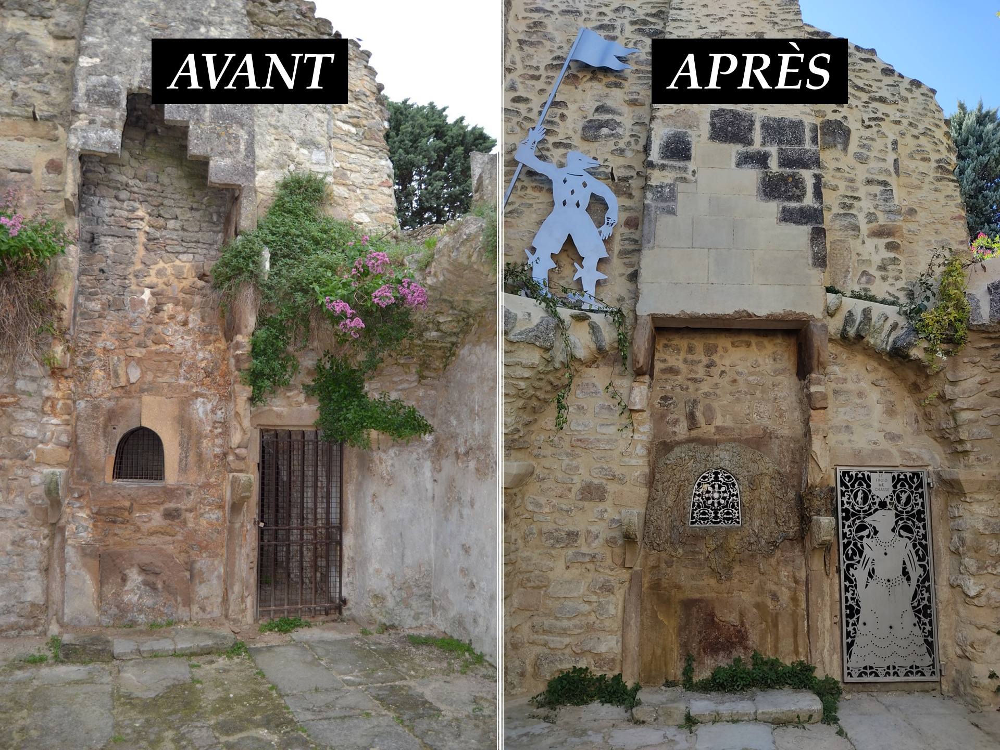

```{=html}
<section class="grignan-home">

<style>
@import url('[https://fonts.googleapis.com/css2?family=Comfortaa:wght@700&display=swap](https://fonts.googleapis.com/css2?family=Comfortaa:wght@700&display=swap)');

/* =====================================
   FOND ET DÉCORATIONS
===================================== */

html, body, #quarto-content {
  background-color: #F4F0E8 !important;
}

.grignan-home {
  font-family: Arial, sans-serif;
  color: #293747;
  max-width: 1100px;
  margin: auto;
  position: relative;
  isolation: isolate;
}

.grignan-home * {
  box-sizing: border-box;
}

/* LAVANDE À DROITE */

.lavande-filigrane {
  position: fixed;
  right: 15px;
  bottom: 10px;
  width: 190px;
  height: auto;
  opacity: 0.28;
  pointer-events: none;
  z-index: -1;
}

/* ÉPI DE BLÉ À GAUCHE */

.ble-filigrane {
  position: fixed;
  left: 8px;
  bottom: 15px;
  width: 175px;
  height: auto;
  opacity: 0.30;
  pointer-events: none;
  z-index: -1;
}

/* =====================================
   INTRODUCTION
===================================== */

.grignan-home .gh-intro {
  text-align: center;
  padding: 45px 25px 35px;
}

.grignan-home .gh-kicker {
  color: #9b784b;
  font-size: 16.8px;
  font-weight: bold;
  letter-spacing: 3px;
  margin-bottom: 20px;
}

.grignan-home .gh-intro h1 {
  font-family: 'Comfortaa', sans-serif;
  font-weight: 700;
  color: #26394d;
  font-size: clamp(38.4px, 6vw, 55.2px);
  line-height: 1.3;
  margin: 0 0 20px;
}

.grignan-home .gh-intro h2 {
  font-family: 'Comfortaa', sans-serif;
  font-size: clamp(22.8px, 3.6vw, 28.8px);
  font-weight: 700;
  color: #c0392b;
  margin: 0 0 28px;
  line-height: 1.5;
}

.grignan-home .gh-intro p {
  max-width: 850px;
  margin: auto;
  color: #59636e;
  font-size: 21.6px;
  line-height: 1.85;
}

.grignan-home .gh-kit {
  max-width: 780px;
  margin: 32px auto 0;
  padding: 22px 26px;
  background: #fcfaf6;
  border-radius: 10px;
  border-left: 5px solid #c0392b;
  font-size: 20.4px;
  line-height: 1.8;
  color: #3a3a3a;
}

/* =====================================
   CHIFFRES CLÉS
===================================== */

.grignan-home .gh-numbers {
  display: grid;
  grid-template-columns: repeat(3, 1fr);
  margin: 35px 0 48px;
  background: #26394d;
  border-radius: 12px;
  overflow: hidden;
  color: white;
}

.grignan-home .gh-number {
  text-align: center;
  padding: 27px 12px;
  border-right: 1px solid #506175;
}

.grignan-home .gh-number:last-child {
  border: none;
}

.grignan-home .gh-number strong {
  display: block;
  color: #dfbd82;
  font-size: 36px;
  margin-bottom: 10px;
}

.grignan-home .gh-number span {
  font-size: 15.6px;
  letter-spacing: 1.2px;
}

/* =====================================
   NAVIGATION
===================================== */

.grignan-home .gh-navigation {
  padding: 15px 0 25px;
}

.grignan-home .gh-heading {
  text-align: center;
  margin-bottom: 32px;
}

.grignan-home .gh-heading h2 {
  font-family: 'Comfortaa', sans-serif;
  font-size: 36px;
  color: #26394d;
  margin: 0 0 12px;
}

.grignan-home .gh-heading p {
  color: #78818a;
  font-size: 20.4px;
}

.grignan-home .gh-buttons {
  display: grid;
  grid-template-columns: repeat(3, 1fr);
  gap: 20px;
}

.grignan-home a.gh-button {
  display: flex;
  align-items: center;
  gap: 18px;
  padding: 22px 20px;
  border-radius: 14px;
  text-decoration: none !important;
  transition: transform .25s, box-shadow .25s;
  min-height: 125px;
}

.grignan-home a.gh-button:hover {
  transform: translateY(-5px);
  box-shadow: 0 12px 25px rgba(0,0,0,.12);
  text-decoration: none !important;
}

/* COULEURS DES BOUTONS */

.grignan-home .gh-button.comprendre {
  background: #e8f5f3;
  border: 2px solid #2a9d8f;
}

.grignan-home .gh-button.agir {
  background: #fdf2e9;
  border: 2px solid #e07a3d;
}

.grignan-home .gh-button.essentiel {
  background: #f4f4f4;
  border: 2px solid #2c2c2c;
}

/* ICÔNES */

.grignan-home .gh-button-icon {
  flex: 0 0 68px;
  width: 68px;
  height: 68px;
  border-radius: 14px;
  display: flex;
  align-items: center;
  justify-content: center;
  font-size: 38.4px;
  color: white;
}

.grignan-home .gh-button.comprendre .gh-button-icon {
  background: #2a9d8f;
}

.grignan-home .gh-button.agir .gh-button-icon {
  background: #e07a3d;
}

.grignan-home .gh-button.essentiel .gh-button-icon {
  background: #1a1a1a;
}

/* TEXTE DES BOUTONS */

.grignan-home .gh-button-content {
  min-width: 0;
}

.grignan-home .gh-button-content h3 {
  font-family: 'Comfortaa', sans-serif;
  margin: 0 0 9px;
  font-size: 24px;
  color: #1a1a1a;
  line-height: 1.4;
}

.grignan-home .gh-button-content p {
  margin: 0;
  font-size: 18px;
  line-height: 1.6;
  color: #555;
}

.grignan-home .gh-button.comprendre .gh-button-content p {
  color: #1a7a6d;
}

.grignan-home .gh-button.agir .gh-button-content p {
  color: #c45c1e;
}

.grignan-home .gh-button.essentiel .gh-button-content p {
  color: #555;
}

/* =====================================
   PHOTO AVANT / APRÈS
===================================== */

.grignan-home .gh-photo {
  text-align: center;
  margin: 40px 0 45px;
}

.grignan-home .gh-photo img {
  display: block;
  width: 720px;
  max-width: 100%;
  height: auto;
  object-fit: contain;
  border-radius: 12px;
  box-shadow: 0 10px 30px rgba(0,0,0,.12);
  margin: 0 auto;
}

.grignan-home .gh-photo-caption {
  margin-top: 16px;
  font-size: 18px;
  color: #666;
  font-style: italic;
}

/* =====================================
   ENCART FINAL
===================================== */

.grignan-home .gh-conclusion {
  background: #fcfaf6;
  border-left: 5px solid #c0392b;
  border-radius: 8px;
  padding: 28px 32px;
  margin: 20px 0 30px;
}

.grignan-home .gh-conclusion h2 {
  font-family: 'Comfortaa', sans-serif;
  color: #26394d;
  font-size: 27.6px;
  margin: 0 0 16px;
}

.grignan-home .gh-conclusion p {
  color: #59636e;
  font-size: 19.2px;
  line-height: 1.9;
  margin: 0;
}

/* =====================================
   FOOTER
===================================== */

.grignan-home .gh-footer {
  text-align: center;
  color: #899098;
  font-size: 15.6px;
  padding: 18px 10px 30px;
}

/* =====================================
   RESPONSIVE
===================================== */

@media(max-width:850px) {

  .grignan-home .gh-buttons {
    grid-template-columns: 1fr;
    max-width: 550px;
    margin: auto;
  }

  .grignan-home .gh-photo img {
    width: 100%;
  }
}

@media(max-width:600px) {

  .lavande-filigrane {
    width: 110px;
    right: -12px;
    bottom: 5px;
    opacity: 0.20;
  }

  .ble-filigrane {
    width: 105px;
    left: -15px;
    bottom: 5px;
    opacity: 0.22;
  }
}

@media(max-width:480px) {

  .grignan-home .gh-numbers {
    grid-template-columns: 1fr;
  }

  .grignan-home .gh-number {
    border-right: none;
    border-bottom: 1px solid #506175;
  }

  .grignan-home .gh-number:last-child {
    border-bottom: none;
  }

  .grignan-home .gh-intro {
    padding: 32px 14px;
  }

  .grignan-home .gh-intro p {
    font-size: 19.2px;
  }

  .grignan-home .gh-kit {
    padding: 18px;
    font-size: 19.2px;
  }

  .grignan-home .gh-button-content h3 {
    font-size: 21.6px;
  }

  .grignan-home .gh-button-content p {
    font-size: 16.8px;
  }

  .grignan-home .gh-heading h2 {
    font-size: 30px;
  }

  .grignan-home .gh-conclusion {
    padding: 22px 20px;
  }

  .grignan-home .gh-conclusion p {
    font-size: 18px;
  }
}

/* =====================================
   IMPRESSION
===================================== */

@media print {

  .lavande-filigrane,
  .ble-filigrane {
    display: none;
  }

}
</style>


<!-- =====================================
     ÉPI DE BLÉ SVG À GAUCHE
===================================== -->

<svg class="ble-filigrane"
     viewBox="0 0 200 430"
     xmlns="[http://www.w3.org/2000/svg](http://www.w3.org/2000/svg)"
     aria-hidden="true">

  <path d="M95 420 Q105 320 92 220 Q83 130 105 35"
        fill="none"
        stroke="#71805B"
        stroke-width="3"
        stroke-linecap="round"/>

  <g fill="#89966C">
    <path d="M98 350 Q55 328 38 290 Q79 302 98 350"/>
    <path d="M95 375 Q136 342 150 303 Q111 319 95 375"/>
    <path d="M93 290 Q48 265 43 228 Q79 246 93 290"/>
    <path d="M90 315 Q128 281 138 244 Q105 263 90 315"/>
    <path d="M91 225 Q52 201 55 164 Q84 184 91 225"/>
    <path d="M91 250 Q130 218 139 184 Q105 198 91 250"/>
  </g>

  <g fill="#C4A15E">
    <ellipse cx="101" cy="42" rx="7" ry="17" transform="rotate(-28 101 42)"/>
    <ellipse cx="86" cy="57" rx="7" ry="16" transform="rotate(-58 86 57)"/>
    <ellipse cx="111" cy="69" rx="7" ry="17" transform="rotate(25 111 69)"/>
    <ellipse cx="79" cy="82" rx="7" ry="16" transform="rotate(-58 79 82)"/>
    <ellipse cx="112" cy="97" rx="7" ry="17" transform="rotate(25 112 97)"/>
    <ellipse cx="77" cy="110" rx="7" ry="16" transform="rotate(-55 77 110)"/>
    <ellipse cx="108" cy="126" rx="7" ry="17" transform="rotate(22 108 126)"/>
    <ellipse cx="80" cy="139" rx="7" ry="15" transform="rotate(-45 80 139)"/>
    <ellipse cx="101" cy="154" rx="7" ry="16" transform="rotate(15 101 154)"/>
    <ellipse cx="88" cy="169" rx="7" ry="15" transform="rotate(-35 88 169)"/>
  </g>

  <g fill="#D3B474">
    <ellipse cx="115" cy="50" rx="6" ry="14" transform="rotate(40 115 50)"/>
    <ellipse cx="96" cy="74" rx="6" ry="14" transform="rotate(-25 96 74)"/>
    <ellipse cx="121" cy="83" rx="6" ry="14" transform="rotate(45 121 83)"/>
    <ellipse cx="91" cy="102" rx="6" ry="14" transform="rotate(-25 91 102)"/>
    <ellipse cx="119" cy="112" rx="6" ry="14" transform="rotate(42 119 112)"/>
    <ellipse cx="91" cy="131" rx="6" ry="13" transform="rotate(-20 91 131)"/>
    <ellipse cx="113" cy="141" rx="6" ry="13" transform="rotate(38 113 141)"/>
    <ellipse cx="94" cy="158" rx="6" ry="12" transform="rotate(-15 94 158)"/>
  </g>

  <g stroke="#B69A61" stroke-width="1.2"
     stroke-linecap="round" opacity="0.9">
    <path d="M101 42L89 15"/>
    <path d="M86 57L66 36"/>
    <path d="M111 69L127 42"/>
    <path d="M79 82L55 63"/>
    <path d="M112 97L132 69"/>
    <path d="M77 110L52 93"/>
    <path d="M108 126L128 101"/>
    <path d="M80 139L58 125"/>
    <path d="M101 154L117 133"/>
    <path d="M88 169L69 155"/>
  </g>

</svg>


<!-- =====================================
     BRIN DE LAVANDE SVG À DROITE
===================================== -->

<svg class="lavande-filigrane"
     viewBox="0 0 200 420"
     xmlns="[http://www.w3.org/2000/svg](http://www.w3.org/2000/svg)"
     aria-hidden="true">

  <path d="M105 410 Q95 300 115 190 Q120 100 145 25"
        fill="none" stroke="#687D58"
        stroke-width="3.5" stroke-linecap="round"/>

  <g fill="#82936D">
    <path d="M105 340 Q55 320 42 278 Q85 290 105 340"/>
    <path d="M103 365 Q145 330 158 292 Q115 310 103 365"/>
    <path d="M108 275 Q60 250 55 215 Q90 230 108 275"/>
    <path d="M112 300 Q150 265 155 230 Q120 250 112 300"/>
    <path d="M115 210 Q78 185 77 155 Q107 175 115 210"/>
    <path d="M120 230 Q155 200 165 170 Q130 185 120 230"/>
    <path d="M130 145 Q102 120 107 92 Q130 110 130 145"/>
    <path d="M135 165 Q165 140 173 112 Q143 128 135 165"/>
  </g>

  <g fill="#9274A9">
    <ellipse cx="145" cy="28" rx="8" ry="14" transform="rotate(20 145 28)"/>
    <ellipse cx="132" cy="40" rx="8" ry="14" transform="rotate(-35 132 40)"/>
    <ellipse cx="155" cy="48" rx="8" ry="14" transform="rotate(35 155 48)"/>
    <ellipse cx="127" cy="60" rx="8" ry="14" transform="rotate(-30 127 60)"/>
    <ellipse cx="151" cy="69" rx="8" ry="14" transform="rotate(30 151 69)"/>
    <ellipse cx="120" cy="81" rx="8" ry="14" transform="rotate(-25 120 81)"/>
    <ellipse cx="144" cy="90" rx="8" ry="14" transform="rotate(25 144 90)"/>
    <ellipse cx="119" cy="105" rx="7" ry="13" transform="rotate(-25 119 105)"/>
    <ellipse cx="138" cy="116" rx="7" ry="13" transform="rotate(25 138 116)"/>
    <ellipse cx="116" cy="130" rx="7" ry="12" transform="rotate(-20 116 130)"/>
    <ellipse cx="132" cy="140" rx="7" ry="12" transform="rotate(25 132 140)"/>
  </g>

  <g fill="#B49AC6">
    <circle cx="145" cy="28" r="2"/>
    <circle cx="132" cy="40" r="2"/>
    <circle cx="155" cy="48" r="2"/>
    <circle cx="127" cy="60" r="2"/>
    <circle cx="151" cy="69" r="2"/>
    <circle cx="120" cy="81" r="2"/>
    <circle cx="144" cy="90" r="2"/>
  </g>

</svg>


<!-- =====================================
     INTRODUCTION
===================================== -->

<div class="gh-intro">

  <div class="gh-kicker">
    GRIGNAN · DRÔME · AFFAIRE DU PORTAIL
  </div>

  <h1>LE FOUR BANAL DE GRIGNAN</h1>

  <h2>Une transformation controversée</h2>

  <p>
    En 2026, une commande publique de 200 000 € a été consacrée à la réalisation d’une installation artistique contemporaine au sein de l’ancien four banal de Grignan. Celle-ci a profondément transformé ce lieu médiéval et soulève de nombreuses questions relatives à la préservation du patrimoine, à l’utilisation de l’argent public et au respect du cadre juridique applicable.
  </p>

  <div class="gh-kit">
    Voici un dossier pour vous informer sur l'affaire du portail « satanique » et vous donner les moyens d'agir efficacement ! 😉
    <br>
    Cliquez sur la rubrique de votre choix : ╰┈➤ˎˊ˗
  </div>

</div>


<!-- =====================================
     CHIFFRES CLÉS
===================================== -->

<div class="gh-numbers">

  <div class="gh-number">
    <strong>200 000 €</strong>
    <span>COMMANDE PUBLIQUE</span>
  </div>

  <div class="gh-number">
    <strong>XIVe siècle</strong>
    <span>ORIGINES DU FOUR BANAL</span>
  </div>

  <div class="gh-number">
    <strong>2026</strong>
    <span>TRANSFORMATION DU SITE</span>
  </div>

</div>


<!-- =====================================
     NAVIGATION
===================================== -->

<div class="gh-navigation">

  <div class="gh-heading">
    <h2>Explorez le dossier</h2>
    <p>Trois entrées pour comprendre, agir et aller à l’essentiel.</p>
  </div>

  <div class="gh-buttons">

    <a class="gh-button comprendre" href="Comprendre.html">
      <div class="gh-button-icon">💡</div>
      <div class="gh-button-content">
        <h3>Comprendre</h3>
        <p>Contexte · Description de l’œuvre · Financements · Aspects juridiques</p>
      </div>
    </a>

    <a class="gh-button agir" href="Agir.html">
      <div class="gh-button-icon">👥</div>
      <div class="gh-button-content">
        <h3>Agir</h3>
        <p>Interpeller · Diffuser · Rassembler</p>
      </div>
    </a>

    <a class="gh-button essentiel" href="lessentiel.html">
      <div class="gh-button-icon">🎬</div>
      <div class="gh-button-content">
        <h3>L’essentiel</h3>
        <p>En 2 minutes !</p>
      </div>
    </a>

  </div>

</div>


<!-- =====================================
     PHOTO AVANT / APRÈS
===================================== -->

<div class="gh-photo">

  

  <div class="gh-photo-caption">
    Le four banal avant et après sa transformation
  </div>

</div>


<!-- =====================================
     CONCLUSION
===================================== -->

<div class="gh-conclusion">

  <h2>Pourquoi ce site ?</h2>

  <p>
    Le patrimoine appartient à tous. Sa transformation, l’utilisation de l’argent public et le respect des règles qui le protègent méritent une information claire et accessible.
    <br><br>
    Ce dossier met les faits et les sources à disposition de chacun, pour que chacun puisse se forger une opinion et, s’il le souhaite, agir.
  </p>

</div>

</section>
```