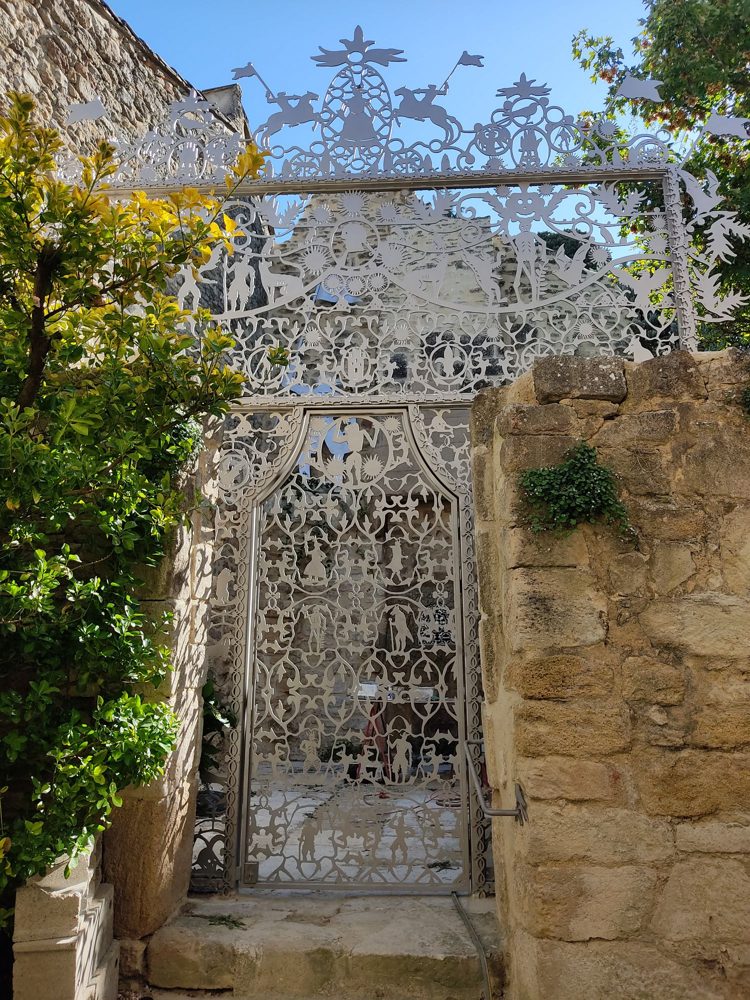
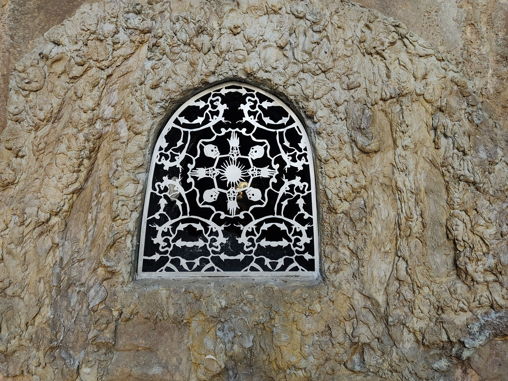
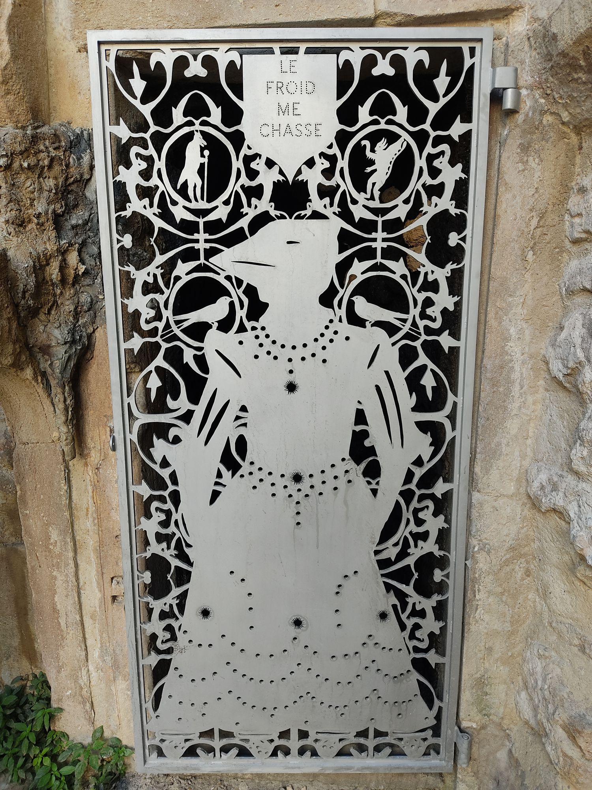
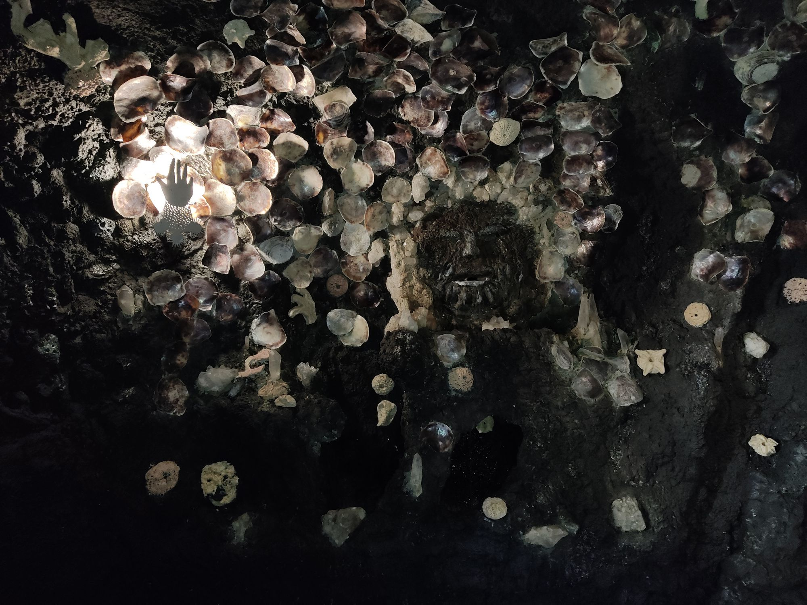

---
title: ""
format:
  html:
    title-block-style: none
    page-layout: full
---

```{=html}
<section class="artwork-page">

<style>
@import url('[https://fonts.googleapis.com/css2?family=Comfortaa:wght@700&display=swap](https://fonts.googleapis.com/css2?family=Comfortaa:wght@700&display=swap)');

/* =====================================
   FOND ET DÉCORATIONS
   IDENTIQUES À LA PAGE CONTEXTE
===================================== */

html, body, #quarto-content {
  background-color: #F4F0E8 !important;
}

.artwork-page {
  font-family: Arial, Helvetica, sans-serif;
  color: #293747;
  background: transparent;
  padding: 35px 22px;
  max-width: 1200px;
  margin: 0 auto;
  position: relative;
  isolation: isolate;
  box-sizing: border-box;
}

.artwork-page * {
  box-sizing: border-box;
}

/* LAVANDE À DROITE */

.lavande-filigrane {
  position: fixed;
  right: 15px;
  bottom: 10px;
  width: 190px;
  height: auto;
  opacity: 0.17;
  pointer-events: none;
  z-index: -1;
}

/* ÉPI DE BLÉ À GAUCHE */

.ble-filigrane {
  position: fixed;
  left: 8px;
  bottom: 15px;
  width: 175px;
  height: auto;
  opacity: 0.19;
  pointer-events: none;
  z-index: -1;
}

/* =====================================
   EN-TÊTE
===================================== */

.artwork-header {
  position: relative;
  text-align: center;
  margin-bottom: 38px;
  padding: 26px 12px 10px;
  overflow: visible;
}

.loupe-filigrane {
  position: absolute;
  left: 50%;
  top: 25%;
  transform: translate(-50%, -50%);
  width: 210px;
  height: auto;
  opacity: 0.14;
  pointer-events: none;
  z-index: -1;
}

.artwork-label {
  display: block;
  color: #9b784b;
  font-size: 14px;
  font-weight: 700;
  letter-spacing: 2px;
  text-transform: uppercase;
  margin-bottom: 12px;
}

.artwork-header h1 {
  color: #26394d;
  font-family: 'Comfortaa', sans-serif;
  font-size: clamp(32px, 5vw, 46px);
  line-height: 1.3;
  margin: 0 0 14px;
  font-weight: 700;
}

.artwork-intro {
  color: #59636e;
  font-size: 18px;
  line-height: 1.7;
  max-width: 900px;
  margin: 0 auto;
}

.artwork-intro em {
  color: #26394d;
  font-weight: 600;
}

/* FILET DÉCORATIF */

.artwork-divider {
  width: 65px;
  height: 4px;
  background: #b49363;
  border-radius: 5px;
  margin: 25px auto 30px;
}

/* =====================================
   GRILLE
===================================== */

.artwork-grid {
  display: grid;
  grid-template-columns: repeat(2, minmax(0, 1fr));
  gap: 22px;
}

/* =====================================
   CARTES
===================================== */

.artwork-item {
  display: flex;
  align-items: stretch;
  min-width: 0;
  background: #ffffff;
  border: 1px solid #e5e0d8;
  border-radius: 12px;
  overflow: hidden;
  box-shadow: 0 4px 15px rgba(38, 57, 77, 0.045);
  transition: transform .2s ease, box-shadow .2s ease;
}

.artwork-item:hover {
  transform: translateY(-3px);
  box-shadow: 0 7px 19px rgba(38,57,77,0.11);
}

/* =====================================
   PHOTOGRAPHIES
===================================== */

.artwork-image {
  flex: 0 0 43%;
  min-width: 0;
  position: relative;
  background: #f7f5f1;
  overflow: hidden;
  display: flex;
}

.artwork-image a {
  display: block;
  width: 100%;
  height: 100%;
}

.artwork-image img {
  display: block;
  width: 100%;
  height: 100%;
  min-height: 235px;
  object-fit: cover;
  transition: transform .35s ease;
}

.artwork-item:hover .artwork-image img {
  transform: scale(1.035);
}

.artwork-image::after {
  content: "";
  position: absolute;
  inset: 0;
  border-right: 1px solid rgba(38,57,77,.08);
  pointer-events: none;
}

/* =====================================
   CONTENU
===================================== */

.artwork-content {
  flex: 1;
  min-width: 0;
  padding: 23px 19px;
  display: flex;
  flex-direction: column;
  justify-content: center;
}

.artwork-number {
  display: block;
  font-size: 13px;
  font-weight: 700;
  letter-spacing: 1.5px;
  color: #a8895d;
  margin-bottom: 12px;
}

.artwork-content h2 {
  font-family: Georgia, serif;
  font-size: 22px;
  line-height: 1.3;
  color: #26394d;
  margin: 0 0 13px;
  font-weight: 600;
}

.artwork-content p {
  font-size: 17px;
  line-height: 1.75;
  color: #4d5965;
  margin: 0;
}

/* PETIT REPÈRE VISUEL */

.artwork-line {
  width: 35px;
  height: 2px;
  background: #b49363;
  margin-bottom: 15px;
}

/* =====================================
   RESPONSIVE
===================================== */

@media (max-width: 850px) {

  .artwork-grid {
    grid-template-columns: 1fr;
    gap: 18px;
  }

  .artwork-image {
    flex-basis: 38%;
  }

  .artwork-image img {
    min-height: 220px;
  }
}

@media (max-width: 750px) {

  .artwork-page {
    padding: 25px 12px;
  }

  .loupe-filigrane {
    width: 165px;
    top: 30%;
    opacity: 0.12;
  }
}

@media (max-width: 600px) {

  .lavande-filigrane {
    width: 110px;
    right: -12px;
    bottom: 5px;
    opacity: 0.12;
  }

  .ble-filigrane {
    width: 105px;
    left: -15px;
    bottom: 5px;
    opacity: 0.13;
  }
}

@media (max-width: 540px) {

  .artwork-header {
    margin-bottom: 25px;
  }

  .artwork-header h1 {
    font-size: 32px;
  }

  .artwork-intro {
    font-size: 17px;
  }

  .artwork-grid {
    gap: 17px;
  }

  .artwork-item {
    flex-direction: column;
  }

  .artwork-image {
    flex: none;
    width: 100%;
    height: 220px;
  }

  .artwork-image img {
    min-height: 0;
    height: 220px;
    object-fit: cover;
  }

  .artwork-content {
    padding: 19px 20px 22px;
  }

  .artwork-content h2 {
    font-size: 21px;
  }

  .artwork-content p {
    font-size: 17px;
  }
}

/* =====================================
   IMPRESSION
===================================== */

@media print {

  .lavande-filigrane,
  .ble-filigrane,
  .loupe-filigrane {
    display: none;
  }

}
</style>


<!-- =====================================
     ÉPI DE BLÉ SVG À GAUCHE
===================================== -->

<svg class="ble-filigrane"
     viewBox="0 0 200 430"
     xmlns="[http://www.w3.org/2000/svg](http://www.w3.org/2000/svg)"
     aria-hidden="true">

  <path d="M95 420 Q105 320 92 220 Q83 130 105 35"
        fill="none"
        stroke="#71805B"
        stroke-width="3"
        stroke-linecap="round"/>

  <g fill="#89966C">
    <path d="M98 350 Q55 328 38 290 Q79 302 98 350"/>
    <path d="M95 375 Q136 342 150 303 Q111 319 95 375"/>
    <path d="M93 290 Q48 265 43 228 Q79 246 93 290"/>
    <path d="M90 315 Q128 281 138 244 Q105 263 90 315"/>
    <path d="M91 225 Q52 201 55 164 Q84 184 91 225"/>
    <path d="M91 250 Q130 218 139 184 Q105 198 91 250"/>
  </g>

  <g fill="#C4A15E">
    <ellipse cx="101" cy="42" rx="7" ry="17" transform="rotate(-28 101 42)"/>
    <ellipse cx="86" cy="57" rx="7" ry="16" transform="rotate(-58 86 57)"/>
    <ellipse cx="111" cy="69" rx="7" ry="17" transform="rotate(25 111 69)"/>
    <ellipse cx="79" cy="82" rx="7" ry="16" transform="rotate(-58 79 82)"/>
    <ellipse cx="112" cy="97" rx="7" ry="17" transform="rotate(25 112 97)"/>
    <ellipse cx="77" cy="110" rx="7" ry="16" transform="rotate(-55 77 110)"/>
    <ellipse cx="108" cy="126" rx="7" ry="17" transform="rotate(22 108 126)"/>
    <ellipse cx="80" cy="139" rx="7" ry="15" transform="rotate(-45 80 139)"/>
    <ellipse cx="101" cy="154" rx="7" ry="16" transform="rotate(15 101 154)"/>
    <ellipse cx="88" cy="169" rx="7" ry="15" transform="rotate(-35 88 169)"/>
  </g>

  <g fill="#D3B474">
    <ellipse cx="115" cy="50" rx="6" ry="14" transform="rotate(40 115 50)"/>
    <ellipse cx="96" cy="74" rx="6" ry="14" transform="rotate(-25 96 74)"/>
    <ellipse cx="121" cy="83" rx="6" ry="14" transform="rotate(45 121 83)"/>
    <ellipse cx="91" cy="102" rx="6" ry="14" transform="rotate(-25 91 102)"/>
    <ellipse cx="119" cy="112" rx="6" ry="14" transform="rotate(42 119 112)"/>
    <ellipse cx="91" cy="131" rx="6" ry="13" transform="rotate(-20 91 131)"/>
    <ellipse cx="113" cy="141" rx="6" ry="13" transform="rotate(38 113 141)"/>
    <ellipse cx="94" cy="158" rx="6" ry="12" transform="rotate(-15 94 158)"/>
  </g>

  <g stroke="#B69A61" stroke-width="1.2"
     stroke-linecap="round" opacity="0.9">
    <path d="M101 42L89 15"/>
    <path d="M86 57L66 36"/>
    <path d="M111 69L127 42"/>
    <path d="M79 82L55 63"/>
    <path d="M112 97L132 69"/>
    <path d="M77 110L52 93"/>
    <path d="M108 126L128 101"/>
    <path d="M80 139L58 125"/>
    <path d="M101 154L117 133"/>
    <path d="M88 169L69 155"/>
  </g>

</svg>


<!-- =====================================
     BRIN DE LAVANDE SVG À DROITE
===================================== -->

<svg class="lavande-filigrane"
     viewBox="0 0 200 420"
     xmlns="[http://www.w3.org/2000/svg](http://www.w3.org/2000/svg)"
     aria-hidden="true">

  <path d="M105 410 Q95 300 115 190 Q120 100 145 25"
        fill="none" stroke="#687D58"
        stroke-width="3.5" stroke-linecap="round"/>

  <g fill="#82936D">
    <path d="M105 340 Q55 320 42 278 Q85 290 105 340"/>
    <path d="M103 365 Q145 330 158 292 Q115 310 103 365"/>
    <path d="M108 275 Q60 250 55 215 Q90 230 108 275"/>
    <path d="M112 300 Q150 265 155 230 Q120 250 112 300"/>
    <path d="M115 210 Q78 185 77 155 Q107 175 115 210"/>
    <path d="M120 230 Q155 200 165 170 Q130 185 120 230"/>
    <path d="M130 145 Q102 120 107 92 Q130 110 130 145"/>
    <path d="M135 165 Q165 140 173 112 Q143 128 135 165"/>
  </g>

  <g fill="#9274A9">
    <ellipse cx="145" cy="28" rx="8" ry="14" transform="rotate(20 145 28)"/>
    <ellipse cx="132" cy="40" rx="8" ry="14" transform="rotate(-35 132 40)"/>
    <ellipse cx="155" cy="48" rx="8" ry="14" transform="rotate(35 155 48)"/>
    <ellipse cx="127" cy="60" rx="8" ry="14" transform="rotate(-30 127 60)"/>
    <ellipse cx="151" cy="69" rx="8" ry="14" transform="rotate(30 151 69)"/>
    <ellipse cx="120" cy="81" rx="8" ry="14" transform="rotate(-25 120 81)"/>
    <ellipse cx="144" cy="90" rx="8" ry="14" transform="rotate(25 144 90)"/>
    <ellipse cx="119" cy="105" rx="7" ry="13" transform="rotate(-25 119 105)"/>
    <ellipse cx="138" cy="116" rx="7" ry="13" transform="rotate(25 138 116)"/>
    <ellipse cx="116" cy="130" rx="7" ry="12" transform="rotate(-20 116 130)"/>
    <ellipse cx="132" cy="140" rx="7" ry="12" transform="rotate(25 132 140)"/>
  </g>

  <g fill="#B49AC6">
    <circle cx="145" cy="28" r="2"/>
    <circle cx="132" cy="40" r="2"/>
    <circle cx="155" cy="48" r="2"/>
    <circle cx="127" cy="60" r="2"/>
    <circle cx="151" cy="69" r="2"/>
    <circle cx="120" cy="81" r="2"/>
    <circle cx="144" cy="90" r="2"/>
  </g>

</svg>


<!-- =====================================
     EN-TÊTE
===================================== -->

<header class="artwork-header">

  <!-- FILIGRANE LOUPE -->
  <svg class="loupe-filigrane"
       viewBox="0 0 220 200"
       xmlns="[http://www.w3.org/2000/svg](http://www.w3.org/2000/svg)"
       aria-hidden="true">

    <!-- Cercle extérieur de la loupe -->
    <circle cx="96" cy="86" r="52"
            fill="none"
            stroke="#26394d"
            stroke-width="6"/>
    <!-- Anneau doré intérieur -->
    <circle cx="96" cy="86" r="43"
            fill="none"
            stroke="#9b784b"
            stroke-width="2.2"
            stroke-dasharray="5 4"/>
    <!-- Reflet discret sur la lentille -->
    <path d="M66 64 A36 36 0 0 1 94 50"
          fill="none"
          stroke="#9b784b"
          stroke-width="2.5"
          stroke-linecap="round"/>

    <!-- Raccord métallique et manche -->
    <line x1="133" y1="123" x2="146" y2="136"
          stroke="#9b784b"
          stroke-width="8"
          stroke-linecap="round"/>
    <line x1="146" y1="136" x2="186" y2="176"
          stroke="#26394d"
          stroke-width="11"
          stroke-linecap="round"/>
    <line x1="150" y1="140" x2="180" y2="170"
          stroke="#9b784b"
          stroke-width="2.2"
          stroke-linecap="round"/>

  </svg>

  <span class="artwork-label">
    DOSSIER DOCUMENTAIRE · GRIGNAN
  </span>

  <h1>Description de l’œuvre</h1>

  <p class="artwork-intro">
    Intitulée <em>Le froid me chasse</em>, l’installation
    d’Hélène Delprat se compose de quatre éléments principaux,
    intégrés à l’ancien four banal de Grignan.
  </p>

  <div class="artwork-divider"></div>

</header>


<!-- =====================================
     LES QUATRE ÉLÉMENTS
===================================== -->

<div class="artwork-grid">

  <!-- 01 PORTAIL -->

  <article class="artwork-item">

    <div class="artwork-image">
      <a href="images/portail.jpg" target="_blank" rel="noopener">
        
      </a>
    </div>

    <div class="artwork-content">
      <span class="artwork-number">ÉLÉMENT 01</span>
      <div class="artwork-line"></div>
      <h2>Le portail</h2>
      <p>
        Une structure métallique à l'iconographie macabre
        ou pouvant être associée au satanisme, notamment
        des têtes de mort, le diable et la faucheuse.
      </p>
    </div>

  </article>


  <!-- 02 GRILLE -->

  <article class="artwork-item">

    <div class="artwork-image">
      <a href="images/grille-four.jpg" target="_blank" rel="noopener">
        
      </a>
    </div>

    <div class="artwork-content">
      <span class="artwork-number">ÉLÉMENT 02</span>
      <div class="artwork-line"></div>
      <h2>La grille de la bouche du four</h2>
      <p>
        Une grille métallique vient fermer l’ouverture de
        l’ancien four, autrefois destinée à la cuisson du pain.
        Elle est ornée de têtes de mort et de motifs évoquant
        des flammes, rappelant l’imagerie d’un four crématoire.
      </p>
    </div>

  </article>


  <!-- 03 MARQUISE -->

  <article class="artwork-item">

    <div class="artwork-image">
      <a href="images/porte-marquise.jpg" target="_blank" rel="noopener">
        
      </a>
    </div>

    <div class="artwork-content">
      <span class="artwork-number">ÉLÉMENT 03</span>
      <div class="artwork-line"></div>
      <h2>La porte représentant la Marquise</h2>
      <p>
        Une représentation déformée de la Marquise de Sévigné,
        dont le visage adopte des traits fantastiques et
        reptiliens. Sa robe, ponctuée de plusieurs perforations,
        laisse également place à une interprétation troublante.
      </p>
    </div>

  </article>


  <!-- 04 CHAMBRE DE LECTURE -->

  <article class="artwork-item">

    <div class="artwork-image">
      <a href="images/chambre-lecture.jpg" target="_blank" rel="noopener">
        
      </a>
    </div>

    <div class="artwork-content">
      <span class="artwork-number">ÉLÉMENT 04</span>
      <div class="artwork-line"></div>
      <h2>La Chambre de lecture</h2>
      <p>
        L'intérieur du four banal est transformé en un espace
        à l'atmosphère sombre, composé de têtes de mort au sol,
        de silhouettes de mains noires, d'un visage crachant
        de l'eau et de jeux de lumière blanche.
      </p>
    </div>

  </article>

</div>

</section>
```