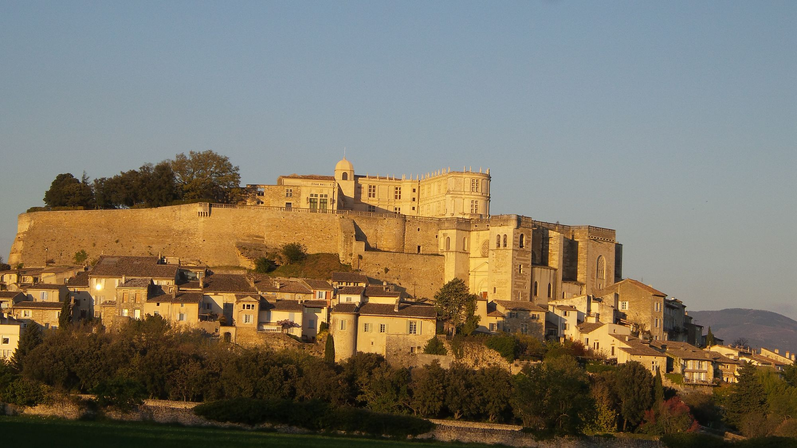
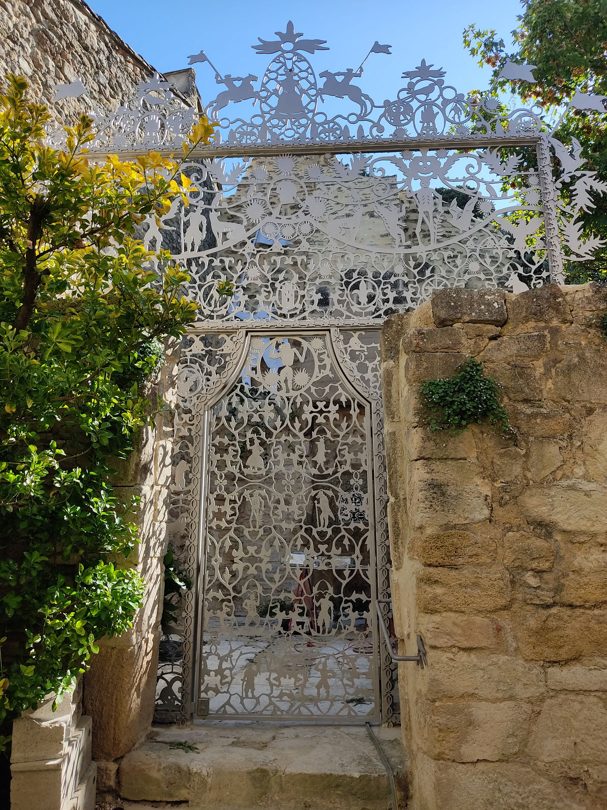
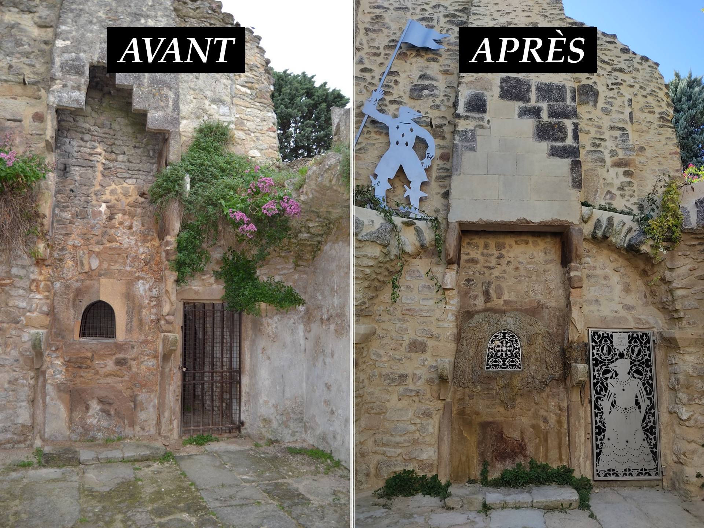

```{=html}
<section class="context-page">

<style>
@import url('[https://fonts.googleapis.com/css2?family=Comfortaa:wght@700&display=swap](https://fonts.googleapis.com/css2?family=Comfortaa:wght@700&display=swap)');

/* =====================================
   FOND ET DÉCORATIONS — IDENTIQUES À L'ACCUEIL
===================================== */

html, body, #quarto-content {
  background-color: #F4F0E8 !important;
}

.context-page {
  font-family: Arial, Helvetica, sans-serif;
  color: #293747;
  background: transparent;
  padding: 35px 22px;
  max-width: 1200px;
  margin: 0 auto;
  position: relative;
  isolation: isolate;
  box-sizing: border-box;
}

.context-page * {
  box-sizing: border-box;
}

/* LAVANDE À DROITE */

.lavande-filigrane {
  position: fixed;
  right: 15px;
  bottom: 10px;
  width: 190px;
  height: auto;
  opacity: 0.17;
  pointer-events: none;
  z-index: -1;
}

/* ÉPI DE BLÉ À GAUCHE */

.ble-filigrane {
  position: fixed;
  left: 8px;
  bottom: 15px;
  width: 175px;
  height: auto;
  opacity: 0.19;
  pointer-events: none;
  z-index: -1;
}

/* =====================================
   EN-TÊTE
===================================== */

.context-header {
  position: relative;
  text-align: center;
  margin-bottom: 38px;
  padding: 26px 12px 14px;
  overflow: visible;
}

.context-filigrane {
  position: absolute;
  left: 50%;
  top: 25%;
  transform: translate(-50%, -50%);
  width: 280px;
  height: auto;
  opacity: 0.14;
  pointer-events: none;
  z-index: -1;
}

.context-eyebrow {
  color: #9b784b;
  font-size: 14px;
  font-weight: 700;
  letter-spacing: 2px;
  text-transform: uppercase;
  margin-bottom: 12px;
}

.context-header h1 {
  color: #26394d;
  font-family: 'Comfortaa', sans-serif;
  font-size: clamp(32px, 5vw, 46px);
  line-height: 1.3;
  margin: 0 0 14px;
  font-weight: 700;
}

.context-header p {
  color: #59636e;
  font-size: 18px;
  line-height: 1.7;
  max-width: 760px;
  margin: 0 auto;
}

/* =====================================
   ENCADRÉS PRINCIPAUX
===================================== */

.context-section {
  background: #ffffff;
  border: 1px solid #e5e0d8;
  border-radius: 12px;
  overflow: hidden;
  margin: 28px 0;
  box-shadow: 0 4px 15px rgba(38, 57, 77, 0.045);
}

.context-section-inner {
  padding: 28px;
  display: grid;
  grid-template-columns: minmax(0, 1fr) 300px;
  gap: 30px;
  align-items: center;
}

.context-text {
  min-width: 0;
}

.context-number {
  color: #a8895d;
  font-size: 14px;
  font-weight: 700;
  letter-spacing: 2px;
  margin-bottom: 10px;
}

.context-section h2 {
  color: #26394d;
  font-family: Georgia, serif;
  font-size: 30px;
  line-height: 1.3;
  margin: 0 0 18px;
  font-weight: 600;
}

.context-section p {
  color: #4d5965;
  font-size: 17px;
  line-height: 1.85;
  margin: 0 0 16px;
}

/* =====================================
   PHOTOGRAPHIES
===================================== */

.context-photo {
  background: #f7f5f1;
  border: 1px solid #e5e0d8;
  border-radius: 10px;
  padding: 9px;
  overflow: hidden;
  box-shadow: 0 3px 12px rgba(38, 57, 77, 0.07);
}

.context-photo img {
  width: 100%;
  height: 235px;
  display: block;
  object-fit: cover;
  border-radius: 6px;
  background: #e9e5de;
}

/* PHOTO AGRANDIE — PARTIE 02 */

.context-photo-artistic img {
  height: 400px;
}

.context-image-caption {
  padding: 12px 7px 5px;
  color: #77736c;
  font-size: 13px;
  line-height: 1.5;
  text-align: center;
  letter-spacing: 0.4px;
}

/* =====================================
   ENCADRÉ DE MISE EN ÉVIDENCE
===================================== */

.context-highlight {
  border-left: 3px solid #b49363;
  background: #f7f5f1;
  padding: 16px 19px;
  margin-top: 20px;
  color: #465363;
  font-size: 16px;
  line-height: 1.75;
}

/* =====================================
   COMPARAISON AVANT / APRÈS
===================================== */

.context-comparison {
  margin-top: 42px;
}

.context-comparison-heading {
  text-align: center;
  margin-bottom: 22px;
}

.context-comparison-heading span {
  display: block;
  color: #9b784b;
  font-size: 13px;
  font-weight: 700;
  letter-spacing: 2px;
  margin-bottom: 10px;
}

.context-comparison-heading h2 {
  font-family: Georgia, serif;
  font-size: clamp(28px, 4vw, 36px);
  color: #26394d;
  margin: 0;
  font-weight: 600;
}

.context-comparison-card {
  background: white;
  border: 1px solid #e5e0d8;
  border-radius: 12px;
  overflow: hidden;
  box-shadow: 0 4px 15px rgba(38, 57, 77, 0.045);
  max-width: 850px;
  margin: 0 auto;
  padding: 12px;
}

.context-comparison-card img {
  width: 100%;
  max-height: 380px;
  object-fit: contain;
  display: block;
  border-radius: 7px;
  background: #f7f5f1;
}

.context-comparison-caption {
  padding: 14px 10px 5px;
  text-align: center;
  color: #596575;
  font-size: 13px;
  font-weight: 700;
  letter-spacing: 1.2px;
}

/* =====================================
   CHRONOLOGIE
===================================== */

.timeline-project {
  width: 100%;
  margin: 0;
  padding: 26px 24px;
  font-family: Arial, Helvetica, sans-serif;
  color: #26394d;
  background: #ffffff;
  border: 1px solid #e5e0d8;
  border-radius: 12px;
  box-shadow: 0 4px 15px rgba(38, 57, 77, 0.045);
  min-width: 0;
}

.timeline-project h2 {
  font-family: Georgia, serif;
  font-size: 30px;
  color: #26394d;
  margin: 0 0 8px;
  padding: 0;
  line-height: 1.3;
  font-weight: 600;
}

.timeline-project .timeline-subtitle {
  color: #777;
  font-size: 17px;
  line-height: 1.6;
  margin: 0 0 30px;
}

.timeline {
  position: relative;
  border-left: 2px solid #b49a70;
  margin-left: 10px;
  padding-left: 25px;
}

.timeline-item {
  position: relative;
  margin-bottom: 30px;
}

.timeline-item:last-child {
  margin-bottom: 0;
}

.timeline-item::before {
  content: "";
  position: absolute;
  left: -33px;
  top: 4px;
  width: 14px;
  height: 14px;
  border-radius: 50%;
  background: #b49a70;
  border: 3px solid white;
  box-shadow: 0 0 0 1px #b49a70;
  box-sizing: content-box;
}

.timeline-date {
  font-size: 16px;
  font-weight: bold;
  color: #94764b;
  margin-bottom: 8px;
  letter-spacing: 0.3px;
}

.timeline-content h3 {
  font-family: Georgia, serif;
  font-size: 21px;
  color: #26394d;
  margin: 0 0 8px;
  line-height: 1.35;
}

.timeline-content p {
  font-size: 17px;
  line-height: 1.7;
  color: #626262;
  margin: 0;
}

/* =====================================
   LIENS
===================================== */

.context-link {
  display: inline-flex;
  align-items: center;
  gap: 7px;
  margin-top: 13px;
  padding: 8px 12px;
  background: #f1f5f9;
  border: 1px solid #dce4ec;
  border-radius: 7px;
  color: #354b63;
  font-size: 13px;
  font-weight: 600;
  line-height: 1.4;
  text-decoration: none;
  transition: background 0.2s ease, border-color 0.2s ease;
}

.context-link:hover {
  background: #e5edf5;
  border-color: #c5d2df;
  color: #26394d;
}

/* BOUTON AVEC SOUS-TITRE */

.context-link-stacked {
  display: inline-flex;
  align-items: center;
  gap: 9px;
  vertical-align: top;
}

.context-link-stacked .link-label {
  display: flex;
  flex-direction: column;
  gap: 2px;
}

.context-link-stacked .link-title {
  font-weight: 700;
}

.context-link-stacked .link-subtitle {
  font-size: 11px;
  font-weight: 400;
  opacity: 0.8;
}

/* GROUPE DE BOUTONS */

.context-links {
  display: flex;
  flex-wrap: wrap;
  align-items: flex-start;
  gap: 9px;
  margin: 2px 0 18px;
}

/* =====================================
   ACTEURS DU PROJET
===================================== */

.project-actors {
  width: 100%;
  margin: 0;
  padding: 26px 24px;
  font-family: Arial, Helvetica, sans-serif;
  color: #26394d;
  background: #ffffff;
  border: 1px solid #e5e0d8;
  border-radius: 12px;
  box-shadow: 0 4px 15px rgba(38, 57, 77, 0.045);
  min-width: 0;
}

.project-actors h2 {
  font-family: Georgia, serif;
  font-size: 30px;
  color: #26394d;
  margin: 0 0 8px;
  padding: 0;
  line-height: 1.3;
  font-weight: 600;
}

.project-actors .actors-subtitle {
  color: #777;
  font-size: 17px;
  line-height: 1.6;
  margin: 0 0 25px;
}

.actors-grid {
  display: grid;
  grid-template-columns: 1fr;
  gap: 13px;
}

.actor-card {
  background: #f7f5f0;
  border: 1px solid #e6e0d5;
  border-radius: 10px;
  padding: 17px 18px;
  transition: transform 0.2s ease, box-shadow 0.2s ease;
}

.actor-card:hover {
  transform: translateY(-3px);
  box-shadow: 0 5px 18px rgba(0,0,0,0.08);
}

.actor-icon {
  font-size: 27px;
  margin-bottom: 8px;
}

.actor-card h3 {
  font-family: Georgia, serif;
  font-size: 21px;
  color: #26394d;
  margin: 0 0 9px;
  line-height: 1.4;
}

.actor-card p {
  color: #626262;
  font-size: 16px;
  line-height: 1.75;
  margin: 0;
}

/* =====================================
   DEUX COLONNES EN BAS DE PAGE
===================================== */

.context-bottom-grid {
  display: grid;
  grid-template-columns: 1fr 1fr;
  gap: 22px;
  align-items: stretch;
  margin-top: 42px;
}

.context-bottom-grid > section {
  min-width: 0;
}

/* =====================================
   RESPONSIVE
===================================== */

@media (max-width: 750px) {

  .context-page {
    padding: 25px 12px;
  }

  .context-filigrane {
    width: 190px;
    top: 30%;
    opacity: 0.12;
  }

  .context-section-inner {
    grid-template-columns: 1fr;
    gap: 20px;
    padding: 22px;
  }

  .context-section h2 {
    font-size: 27px;
  }

  .context-photo {
    max-width: 430px;
    width: 100%;
    margin: 0 auto;
  }

  .context-photo img {
    height: 220px;
  }

  /* PHOTO 02 : HAUTEUR AUGMENTÉE DE 50 % SUR MOBILE */

  .context-photo-artistic img {
    height: 330px;
  }

  .context-bottom-grid {
    grid-template-columns: 1fr;
    gap: 20px;
    margin-top: 35px;
  }

  .timeline-project,
  .project-actors {
    padding: 23px 20px;
  }

  .timeline-project h2,
  .project-actors h2 {
    font-size: 27px;
  }

  .timeline {
    padding-left: 23px;
  }

  .timeline-item::before {
    left: -31px;
  }
}

@media(max-width:600px) {

  .lavande-filigrane {
    width: 110px;
    right: -12px;
    bottom: 5px;
    opacity: 0.12;
  }

  .ble-filigrane {
    width: 105px;
    left: -15px;
    bottom: 5px;
    opacity: 0.13;
  }
}

@media (max-width: 420px) {

  .context-section-inner {
    padding: 18px;
  }

  .context-photo img {
    height: 190px;
  }

  /* PHOTO 02 : HAUTEUR AUGMENTÉE DE 50 % SUR PETIT ÉCRAN */

  .context-photo-artistic img {
    height: 285px;
  }

  .context-header p {
    font-size: 17px;
  }
}

/* =====================================
   IMPRESSION
===================================== */

@media print {

  .lavande-filigrane,
  .ble-filigrane,
  .context-filigrane {
    display: none;
  }

}
</style>


<!-- =====================================
     ÉPI DE BLÉ SVG À GAUCHE
     REPRIS À L'IDENTIQUE DE L'ACCUEIL
===================================== -->

<svg class="ble-filigrane"
     viewBox="0 0 200 430"
     xmlns="[http://www.w3.org/2000/svg](http://www.w3.org/2000/svg)"
     aria-hidden="true">

  <path d="M95 420 Q105 320 92 220 Q83 130 105 35"
        fill="none"
        stroke="#71805B"
        stroke-width="3"
        stroke-linecap="round"/>

  <g fill="#89966C">
    <path d="M98 350 Q55 328 38 290 Q79 302 98 350"/>
    <path d="M95 375 Q136 342 150 303 Q111 319 95 375"/>
    <path d="M93 290 Q48 265 43 228 Q79 246 93 290"/>
    <path d="M90 315 Q128 281 138 244 Q105 263 90 315"/>
    <path d="M91 225 Q52 201 55 164 Q84 184 91 225"/>
    <path d="M91 250 Q130 218 139 184 Q105 198 91 250"/>
  </g>

  <g fill="#C4A15E">
    <ellipse cx="101" cy="42" rx="7" ry="17" transform="rotate(-28 101 42)"/>
    <ellipse cx="86" cy="57" rx="7" ry="16" transform="rotate(-58 86 57)"/>
    <ellipse cx="111" cy="69" rx="7" ry="17" transform="rotate(25 111 69)"/>
    <ellipse cx="79" cy="82" rx="7" ry="16" transform="rotate(-58 79 82)"/>
    <ellipse cx="112" cy="97" rx="7" ry="17" transform="rotate(25 112 97)"/>
    <ellipse cx="77" cy="110" rx="7" ry="16" transform="rotate(-55 77 110)"/>
    <ellipse cx="108" cy="126" rx="7" ry="17" transform="rotate(22 108 126)"/>
    <ellipse cx="80" cy="139" rx="7" ry="15" transform="rotate(-45 80 139)"/>
    <ellipse cx="101" cy="154" rx="7" ry="16" transform="rotate(15 101 154)"/>
    <ellipse cx="88" cy="169" rx="7" ry="15" transform="rotate(-35 88 169)"/>
  </g>

  <g fill="#D3B474">
    <ellipse cx="115" cy="50" rx="6" ry="14" transform="rotate(40 115 50)"/>
    <ellipse cx="96" cy="74" rx="6" ry="14" transform="rotate(-25 96 74)"/>
    <ellipse cx="121" cy="83" rx="6" ry="14" transform="rotate(45 121 83)"/>
    <ellipse cx="91" cy="102" rx="6" ry="14" transform="rotate(-25 91 102)"/>
    <ellipse cx="119" cy="112" rx="6" ry="14" transform="rotate(42 119 112)"/>
    <ellipse cx="91" cy="131" rx="6" ry="13" transform="rotate(-20 91 131)"/>
    <ellipse cx="113" cy="141" rx="6" ry="13" transform="rotate(38 113 141)"/>
    <ellipse cx="94" cy="158" rx="6" ry="12" transform="rotate(-15 94 158)"/>
  </g>

  <g stroke="#B69A61" stroke-width="1.2"
     stroke-linecap="round" opacity="0.9">
    <path d="M101 42L89 15"/>
    <path d="M86 57L66 36"/>
    <path d="M111 69L127 42"/>
    <path d="M79 82L55 63"/>
    <path d="M112 97L132 69"/>
    <path d="M77 110L52 93"/>
    <path d="M108 126L128 101"/>
    <path d="M80 139L58 125"/>
    <path d="M101 154L117 133"/>
    <path d="M88 169L69 155"/>
  </g>

</svg>


<!-- =====================================
     BRIN DE LAVANDE SVG À DROITE
     REPRIS À L'IDENTIQUE DE L'ACCUEIL
===================================== -->

<svg class="lavande-filigrane"
     viewBox="0 0 200 420"
     xmlns="[http://www.w3.org/2000/svg](http://www.w3.org/2000/svg)"
     aria-hidden="true">

  <path d="M105 410 Q95 300 115 190 Q120 100 145 25"
        fill="none" stroke="#687D58"
        stroke-width="3.5" stroke-linecap="round"/>

  <g fill="#82936D">
    <path d="M105 340 Q55 320 42 278 Q85 290 105 340"/>
    <path d="M103 365 Q145 330 158 292 Q115 310 103 365"/>
    <path d="M108 275 Q60 250 55 215 Q90 230 108 275"/>
    <path d="M112 300 Q150 265 155 230 Q120 250 112 300"/>
    <path d="M115 210 Q78 185 77 155 Q107 175 115 210"/>
    <path d="M120 230 Q155 200 165 170 Q130 185 120 230"/>
    <path d="M130 145 Q102 120 107 92 Q130 110 130 145"/>
    <path d="M135 165 Q165 140 173 112 Q143 128 135 165"/>
  </g>

  <g fill="#9274A9">
    <ellipse cx="145" cy="28" rx="8" ry="14" transform="rotate(20 145 28)"/>
    <ellipse cx="132" cy="40" rx="8" ry="14" transform="rotate(-35 132 40)"/>
    <ellipse cx="155" cy="48" rx="8" ry="14" transform="rotate(35 155 48)"/>
    <ellipse cx="127" cy="60" rx="8" ry="14" transform="rotate(-30 127 60)"/>
    <ellipse cx="151" cy="69" rx="8" ry="14" transform="rotate(30 151 69)"/>
    <ellipse cx="120" cy="81" rx="8" ry="14" transform="rotate(-25 120 81)"/>
    <ellipse cx="144" cy="90" rx="8" ry="14" transform="rotate(25 144 90)"/>
    <ellipse cx="119" cy="105" rx="7" ry="13" transform="rotate(-25 119 105)"/>
    <ellipse cx="138" cy="116" rx="7" ry="13" transform="rotate(25 138 116)"/>
    <ellipse cx="116" cy="130" rx="7" ry="12" transform="rotate(-20 116 130)"/>
    <ellipse cx="132" cy="140" rx="7" ry="12" transform="rotate(25 132 140)"/>
  </g>

  <g fill="#B49AC6">
    <circle cx="145" cy="28" r="2"/>
    <circle cx="132" cy="40" r="2"/>
    <circle cx="155" cy="48" r="2"/>
    <circle cx="127" cy="60" r="2"/>
    <circle cx="151" cy="69" r="2"/>
    <circle cx="120" cy="81" r="2"/>
    <circle cx="144" cy="90" r="2"/>
  </g>

</svg>


<!-- =====================================
     EN-TÊTE
===================================== -->

<header class="context-header">

  <!-- FILIGRANE LIVRE & HORLOGE -->
  <svg class="context-filigrane"
       viewBox="0 0 280 170"
       xmlns="[http://www.w3.org/2000/svg](http://www.w3.org/2000/svg)"
       aria-hidden="true">

    <!-- Livre ouvert à gauche -->
    <path d="M36 58 Q74 52 108 66 L108 134 Q74 120 36 126 Z"
          fill="none"
          stroke="#26394d"
          stroke-width="3"
          stroke-linejoin="round"/>
    <path d="M108 66 Q142 52 180 58 L180 126 Q142 120 108 134 Z"
          fill="none"
          stroke="#26394d"
          stroke-width="3"
          stroke-linejoin="round"/>
    <line x1="108" y1="66" x2="108" y2="134"
          stroke="#9b784b"
          stroke-width="2.5"/>

    <!-- Lignes de texte stylisées sur les pages -->
    <line x1="50" y1="76" x2="94" y2="82" stroke="#9b784b" stroke-width="1.8" stroke-linecap="round"/>
    <line x1="50" y1="90" x2="94" y2="96" stroke="#9b784b" stroke-width="1.8" stroke-linecap="round"/>
    <line x1="50" y1="104" x2="84" y2="109" stroke="#9b784b" stroke-width="1.8" stroke-linecap="round"/>

    <line x1="122" y1="82" x2="166" y2="76" stroke="#9b784b" stroke-width="1.8" stroke-linecap="round"/>
    <line x1="122" y1="96" x2="166" y2="90" stroke="#9b784b" stroke-width="1.8" stroke-linecap="round"/>
    <line x1="122" y1="110" x2="154" y2="105" stroke="#9b784b" stroke-width="1.8" stroke-linecap="round"/>

    <!-- Horloge / cadran à droite -->
    <circle cx="218" cy="76" r="34"
            fill="#F4F0E8"
            stroke="#26394d"
            stroke-width="3.2"/>
    <circle cx="218" cy="76" r="28"
            fill="none"
            stroke="#9b784b"
            stroke-width="1.6"
            stroke-dasharray="2 5.3"/>

    <!-- Couronne supérieure de l'horloge -->
    <rect x="213" y="34" width="10" height="7" rx="2" fill="#9b784b"/>
    <circle cx="218" cy="31" r="3" fill="none" stroke="#26394d" stroke-width="2"/>

    <!-- Aiguilles de l'horloge -->
    <line x1="218" y1="76" x2="218" y2="56"
          stroke="#26394d"
          stroke-width="3"
          stroke-linecap="round"/>
    <line x1="218" y1="76" x2="235" y2="84"
          stroke="#9b784b"
          stroke-width="2.8"
          stroke-linecap="round"/>
    <circle cx="218" cy="76" r="3.5" fill="#26394d"/>

  </svg>

  <div class="context-eyebrow">Dossier documentaire · Grignan</div>
  <h1>Contexte du projet</h1>
  <p>
    De l'histoire médiévale du four banal à sa transformation artistique
    en 2026 : retour sur l'évolution d'un lieu emblématique du patrimoine
    de Grignan.
  </p>
</header>


<!-- =====================================
     01 : PATRIMOINE HISTORIQUE
===================================== -->

<article class="context-section">
  <div class="context-section-inner">
    <div class="context-text">
      <div class="context-number">01 — REPÈRES HISTORIQUES</div>
      <h2>Un patrimoine historique</h2>
      <p>
        Le village de Grignan possède un riche patrimoine médiéval,
        marqué notamment par son château et la figure emblématique
        de la marquise de Sévigné, mais aussi par son ancien four banal.
      </p>
      <p>
        Au Moyen Âge, celui-ci occupait une place essentielle dans
        la vie quotidienne des habitants, qui étaient tenus d'y faire
        cuire leur pain moyennant une redevance seigneuriale appelée
        « banalité ».
      </p>
    </div>
    <div class="context-photo">
      
      <div class="context-image-caption">L'ancien four banal de Grignan</div>
    </div>
  </div>
</article>


<!-- =====================================
     02 : TRANSFORMATIONS DE 2026
===================================== -->

<article class="context-section">
  <div class="context-section-inner">
    <div class="context-text">
      <div class="context-number">02 — COMMANDE ARTISTIQUE</div>
      <h2>Les transformations de 2026</h2>

      <p>
        En 2026, dans le cadre des célébrations du 400<sup>e</sup>
        anniversaire de la naissance de la marquise de Sévigné,
        l'ancien four banal a connu une transformation artistique
        avec l'installation d'une œuvre réalisée par Hélène Delprat.
        Celle-ci a été inaugurée le 19 septembre 2026, à l'occasion
        des Journées européennes du patrimoine, dont le thème officiel
        était « Patrimoine en péril : raviver, résister, réinventer ».
      </p>

      <!-- BOUTONS DE RÉFÉRENCE -->

      <div class="context-links">

        <a class="context-link"
           href="https://www.ledauphine.com/culture-loisirs/2026/09/20/au-four-banal-une-chambre-de-lecture-qui-invite-a-la-reverie"
           target="_blank"
           rel="noopener noreferrer">
          📰 Lire l'article du Dauphiné Libéré ↗
        </a>

        <a class="context-link context-link-stacked"
           href="https://www.coe.int/fr/web/portal/-/european-heritage-days-2026-heritage-at-risk-revive-resist-reimagine"
           target="_blank"
           rel="noopener noreferrer">
          🇪🇺
          <span class="link-label">
            <span class="link-title">Conseil de l'Europe ↗</span>
            <span class="link-subtitle">Thème officiel des JEP 2026</span>
          </span>
        </a>

      </div>

      <p>
        L'ensemble comprend notamment une « Chambre de lecture »
        ainsi qu'un portail monumental dont l'iconographie, marquée
        par des motifs macabres et démoniaques, a été jugée par
        certains habitants comme pouvant être associée au satanisme.
      </p>

      <div class="context-highlight">
        Cette intervention a profondément modifié l'apparence
        et l'aménagement intérieur de l'ancien four banal, suscitant
        des interrogations sur le rapport entre l'œuvre, l'histoire
        du lieu et la préservation du patrimoine.
      </div>
    </div>

    <div class="context-photo context-photo-artistic">
      
      <div class="context-image-caption">
        L'ancien four banal après son intervention artistique en 2026
      </div>
    </div>
  </div>
</article>


<!-- =====================================
     COMPARAISON AVANT / APRÈS
===================================== -->

<section class="context-comparison">
  <div class="context-comparison-heading">
    <span>ÉVOLUTION DU SITE</span>
    <h2>Le four banal avant et après sa transformation</h2>
  </div>
  <div class="context-comparison-card">
    
    <div class="context-comparison-caption">AVANT / APRÈS — COMPARAISON PHOTOGRAPHIQUE</div>
  </div>
</section>


<!-- =====================================
     GRANDES ÉTAPES ET ACTEURS
===================================== -->

<div class="context-bottom-grid">

  <section class="timeline-project">
    <h2>Les grandes étapes du projet</h2>
    <p class="timeline-subtitle">De la décision municipale à l'inauguration</p>
    <div class="timeline">

      <div class="timeline-item">
        <div class="timeline-date">3 avril 2025</div>
        <div class="timeline-content">
          <h3>Délibération municipale</h3>
          <p>Délibération du conseil municipal relative au projet artistique.</p>
          <a class="context-link" href="https://www.ville-grignan.fr/fr/decouvrir-la-commune/compte-rendus-des-conseils-municipaux.html" target="_blank" rel="noopener noreferrer">
            🗳️ Consulter la délibération n° 14 ↗
          </a>
        </div>
      </div>

      <div class="timeline-item">
        <div class="timeline-date">Février 2026</div>
        <div class="timeline-content">
          <h3>Annonce du projet</h3>
          <p>Annonce de l'installation de l'œuvre d'Hélène Delprat dans le bulletin municipal de Grignan.</p>
          <a class="context-link" href="https://www.ville-grignan.fr/fr/decouvrir-la-commune/grignan-infos.html" target="_blank" rel="noopener noreferrer">
            📰 Consulter Grignan Infos n° 117 ↗
          </a>
        </div>
      </div>

      <div class="timeline-item">
        <div class="timeline-date">Mars – septembre 2026</div>
        <div class="timeline-content">
          <h3>Réalisation des travaux</h3>
          <p>Mise en œuvre et réalisation du projet artistique.</p>
        </div>
      </div>

      <div class="timeline-item">
        <div class="timeline-date">19 septembre 2026</div>
        <div class="timeline-content">
          <h3>Inauguration</h3>
          <p>Inauguration de l'installation à l'occasion des Journées européennes du patrimoine.</p>
          <a class="context-link" href="https://www.ledauphine.com/culture-loisirs/2026/09/20/au-four-banal-une-chambre-de-lecture-qui-invite-a-la-reverie" target="_blank" rel="noopener noreferrer">
            📰 Lire l'article du Dauphiné Libéré ↗
          </a>
        </div>
      </div>

    </div>
  </section>


  <section class="project-actors">
    <h2>Les acteurs du projet</h2>
    <p class="actors-subtitle">Les principaux intervenants de la transformation du four banal</p>
    <div class="actors-grid">

      <article class="actor-card">
        <div class="actor-icon">🏛️</div>
        <h3>La municipalité de Grignan</h3>
        <p>À l'initiative du projet et responsable de sa mise en œuvre dans le cadre de la commande publique.</p>
      </article>

      <article class="actor-card">
        <div class="actor-icon">🎨</div>
        <h3>Hélène Delprat</h3>
        <p>
          Artiste plasticienne, diplômée de l'École des Beaux-Arts de Paris et conceptrice de l'installation artistique intitulée
          <em>Le froid me chasse</em>.
        </p>
        <a class="context-link" href="https://helenedelprat.com/" target="_blank" rel="noopener noreferrer">
          🌐 Consulter son site officiel ↗
        </a>
      </article>

      <article class="actor-card">
        <div class="actor-icon">🗳️</div>
        <h3>Bruno Durieux</h3>
        <p>
          Ancien maire de Grignan et ministre délégué à la Santé (1990-1992), puis au Commerce extérieur (1992-1993),
          sous François Mitterrand. Il contribua également à abaisser le numerus clausus sous le seuil des 4 000 places,
          participant à la pénurie de médecins qui s'ensuivit.
        </p>
        <a class="context-link" href="https://www.franceinfo.fr/sante/loi-sante/le-numerus-clausus-est-il-responsable-de-la-penurie-de-medecins_3455461.html" target="_blank" rel="noopener noreferrer">
          📰 Lire l'article de Franceinfo (2019) ↗
        </a>
      </article>

      <article class="actor-card">
        <div class="actor-icon">🏢</div>
        <h3>Direction régionale des affaires culturelles (DRAC)</h3>
        <p>Service déconcentré du ministère de la Culture, chargé notamment de mettre en œuvre la politique culturelle de l'État en région.</p>
      </article>

    </div>
  </section>

</div>

</section>
```